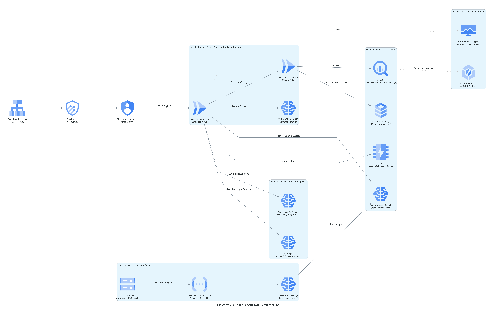
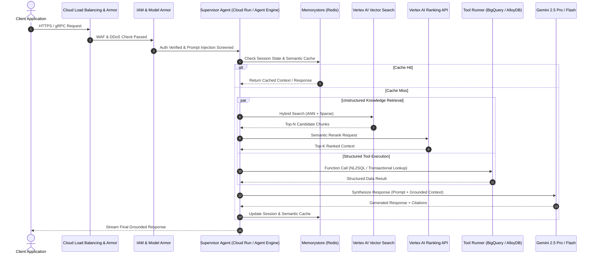

# Enterprise Multi-Agent RAG Architecture on Google Cloud (Vertex AI)


## Overview

This repository provides a **Diagram-as-Code** implementation for an enterprise-grade, multi-agent Retrieval-Augmented Generation (RAG) system built on **Google Cloud Platform (GCP)** and **Vertex AI**. 

Designed for AI/ML and Cloud Architects, this project treats system architecture diagrams as version-controlled software artifacts—eliminating documentation drift across the complete Software Development Life Cycle (SDLC).

---

## Architecture Blueprint



### Runtime Request Sequence (Mermaid.js)



---

## Technical Component Breakdown

### 1. Ingress, Edge Security & AI Guardrails
* **Cloud Load Balancing & API Gateway:** Handles global anycast routing, TLS termination, rate limiting, and API key/OAuth management.
* **Cloud Armor:** Provides perimeter Web Application Firewall (WAF) protection and DDoS mitigation.
* **IAM & Model Armor:** Enforces zero-trust Identity and Access Management alongside **Model Armor**, screening prompts and responses for prompt injection, jailbreaks, sensitive data leakage (PII), and harmful content.

### 2. Offline Data Ingestion & Indexing Pipeline
* **Cloud Storage (GCS):** Landing zone for raw unstructured documents (PDFs, HTML, Office docs, and multimodal assets).
* **Eventarc & Cloud Functions / Workflows:** Event-driven serverless pipeline triggered on object creation (`google.cloud.storage.object.v1.finalized`) to perform document parsing, semantic chunking, and Cloud DLP PII redaction.
* **Vertex AI Embeddings (`text-embedding-005`):** Generates dense vector representations and sparse lexical tokens streamed directly into the vector index.

### 3. Agentic Runtime & Orchestration
* **Supervisor & Worker Agents (Cloud Run / Vertex AI Agent Engine):** Containerized multi-agent orchestration (built with LangGraph or Google Agent Development Kit) that decomposes user intent and delegates tasks.
* **Vertex AI Ranking API:** Managed semantic cross-encoder reranker that re-scores retrieved chunks to maximize context precision before LLM synthesis.
* **Tool Execution Service (Cloud Run):** Isolated microservice executing deterministic function calls, API integrations, and sandboxed code execution.

### 4. Knowledge, Memory & Analytics Layer
* **Vertex AI Vector Search:** Managed, low-latency ScaNN-backed vector database supporting hybrid (dense + sparse) search and metadata filtering at billion-scale.
* **Memorystore (Redis):** Sub-millisecond in-memory store managing multi-turn conversational state and semantic caching to reduce LLM latency and token costs.
* **AlloyDB / Cloud SQL (PostgreSQL + `pgvector`):** Operational relational store for document metadata, user permissions (RBAC/ABAC), and transactional lookups.
* **BigQuery:** Enterprise data warehouse supporting Natural-Language-to-SQL (NL2SQL) analytics and storing structured inference logs for continuous evaluation.

### 5. Vertex AI Model Garden & Inference Tier
* **Gemini 2.5 Pro / Flash:** Managed multimodal foundation models handling complex multi-step reasoning, agent routing, and grounded synthesis.
* **Vertex AI Endpoints:** Dedicated GPU/TPU endpoints hosting fine-tuned open-weight models (Llama, Gemma, Mistral) for specialized, low-latency, or compliance-bound workloads.

### 6. LLMOps, Evaluation & Observability
* **Cloud Trace & Cloud Logging:** Captures end-to-end distributed traces across agent hops, tool latency, token consumption, and retrieval scores.
* **Vertex AI Evaluation & Cloud Build:** Automated CI/CD evaluation pipelines measuring groundedness, relevance, and hallucination rates against BigQuery production logs.

---

## Repository Structure

```text
diagram_generation/
├── .github/
│   └── workflows/
│       └── render-diagrams.yml                     # CI/CD workflow for auto-rendering diagrams
├── docs/
│   └── adr/
│       └── 001-vertex-ai-multi-agent-rag-stack.md  # Architecture Decision Record (MADR)
├── terraform/
│   └── main.tf                                     # GCP IaC (Vertex AI, Cloud Run, Redis, BQ, GCS)
├── gcp_vertex_rag_arch.py                          # Diagram-as-Code Python source script
├── gcp_vertex_rag_arch.png                         # Generated 150-DPI architecture blueprint
├── gcp_vertex_rag_arch.svg                         # Generated vector architecture blueprint
├── requirements.txt                                # Python dependencies (diagrams)
├── .gitignore                                      # Excludes .venv, .terraform, state & secrets
└── README.md                                       # Complete system architecture documentation
```

---

## Prerequisites & Local Setup

### 1. System Dependency: Graphviz
The Python `diagrams` library relies on the **Graphviz** rendering engine (`dot` executable).

* **Windows (PowerShell):**
  ```powershell
  winget install Graphviz.Graphviz

  # Permanently add Graphviz to User PATH (restart terminal afterward)
  [Environment]::SetEnvironmentVariable(
      "Path",
      [Environment]::GetEnvironmentVariable("Path", "User") + ";C:\Program Files\Graphviz\bin",
      "User"
  )
  ```
* **macOS (Homebrew):**
  ```bash
  brew install graphviz
  ```
* **Ubuntu / Debian:**
  ```bash
  sudo apt-get update && sudo apt-get install -y graphviz
  ```

Verify installation:
```bash
dot -V
```

### 2. Python Environment Setup

```bash
# Create and activate virtual environment
python -m venv .venv

# Windows PowerShell
.\.venv\Scripts\Activate.ps1

# macOS / Linux
source .venv/bin/activate

# Install dependencies
pip install diagrams
```

---

## Generating the Diagram

Run the Python script to compile and export the latest PNG diagram:

```bash
python gcp_vertex_rag_arch.py
```

### Customization Parameters
You can modify the layout inside `gcp_vertex_rag_arch.py` via `graph_attr`:
* `direction="LR"`: Left-to-right flow (change to `"TB"` for top-to-bottom).
* `splines="ortho"`: Clean right-angle connector lines (change to `"polyline"` or `"curved"` if edge labels overlap).
* `outformat="png"`: Add `outformat="svg"` inside `Diagram(...)` for lossless vector exports suitable for web portals and slide decks.

---

## CI/CD Integration (Optional)

To automatically regenerate `gcp_vertex_rag_arch.png` whenever `gcp_vertex_rag_arch.py` is modified in a Pull Request, add `.github/workflows/render-diagrams.yml`:

```yaml
name: Render Architecture Diagrams

on:
  push:
    paths:
      - '**.py'

jobs:
  build-diagrams:
    runs-on: ubuntu-latest
    steps:
      - uses: actions/checkout@v4
      - name: Install Graphviz
        run: sudo apt-get update && sudo apt-get install -y graphviz
      - name: Set up Python
        uses: actions/setup-python@v5
        with:
          python-version: '3.12'
      - name: Install Python dependencies
        run: pip install diagrams
      - name: Generate Diagrams
        run: python gcp_vertex_rag_arch.py
      - name: Commit updated diagram
        run: |
          git config --local user.email "action@github.com"
          git config --local user.name "GitHub Action"
          git add *.png
          git diff --quiet && git diff --staged --quiet || git commit -m "docs: auto-update architecture diagram"
          git push
```

## Infrastructure Provisioning (Terraform)

The `terraform/main.tf` module provisions the foundational GCP services modeled in the architecture diagram, including private VPC networking, least-privilege IAM, Vertex AI Vector Search (ScaNN), Memorystore for Redis, BigQuery telemetry tables, and Cloud Run v2 services.

---

### Multi-Environment Usage (Workspaces or `.tfvars`)

You can now switch cleanly between environments using Terraform Workspaces and environment files (e.g., `envs/dev.tfvars`, `envs/staging.tfvars`, `envs/prod.tfvars`—kept gitignored via `*.tfvars`):

```bash
cd terraform

# Create isolated state workspaces
terraform workspace new dev
terraform workspace new staging
terraform workspace new prod

# Deploy to Staging
terraform workspace select staging
terraform apply -var="project_id=my-gcp-staging-id" -var="environment=staging"

# Deploy to Production (automatically provisions HA Redis, Medium ScaNN shards, and min_instances=2)
terraform workspace select prod
terraform apply -var="project_id=my-gcp-prod-id" -var="environment=prod"
```